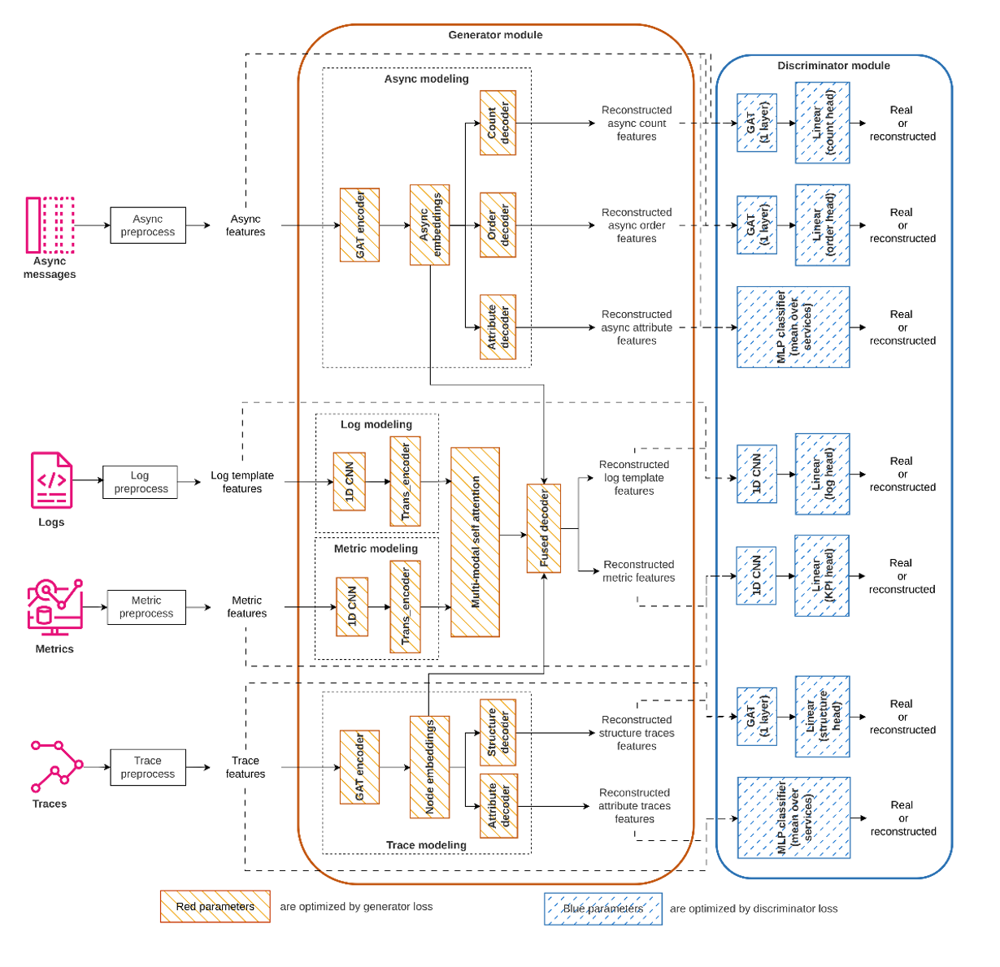

<h1 align="center">UAM-AD</h1>

<p align="center">
  <b>UAM-AD: Unsupervised Adversarial Multi-modal approach for Anomaly Detection in microservices</b>
</p>

<p align="center">
  
  
  
  
</p>

<p align="center">
  Source code of the master's thesis on UAM-AD. UAM-AD extends <b>UAC-AD</b> ("Unsupervised Adversarial Contrastive Learning for Anomaly Detection on Multi-source Data", logs + metrics) with a <b>TraceDAE-style trace branch</b> (GAT over the service call graph, plus an async branch for message-based calls). It is trained on normal data only and needs no anomaly labels.
</p>

---

## Table of Contents

- [Key Features](#key-features)
- [Architecture Overview](#architecture-overview)
- [Getting Started](#getting-started)
- [Datasets](#datasets)
- [Evaluation Protocol](#evaluation-protocol)
- [Running Experiments](#running-experiments)
- [Results](#results)
- [Key Arguments](#key-arguments)
- [Project Structure](#project-structure)
- [Documentation](#documentation)
- [Citation](#citation)

---

## Key Features

- **Unsupervised**: trains on normal data only; anomaly labels are used for evaluation, never for training.
- **Logs + metrics + traces**: the UAC-AD log/metric core (Transformer encoders, multi-modal self-attention, GAN + contrastive training) plus a trace branch.
- **Residual-gated trace fusion**: the trace branch is *not* mixed into the log/metric self-attention. It is a side branch added to the decoder through a zero-initialised gate, so the model starts as the log+metric baseline and the gate opens only if trace helps reconstruction.
- **Sync and async traces**: a sync branch (GAT on the RPC call graph, `trace_model_v3.py`) and an async branch (message-count and temporal-order reconstruction, `async_trace_model_v3.py`) for message-queue / `@Async` calls.
- **Root cause localization (RCA)**: ranks services by normalised per-node trace score + per-service metric reconstruction error, reported as HR@1/3/5 (`--enable_rca True`).
- **Fair, frozen protocol**: one shared config for UAM-AD and UAC-AD (`codes/common/frozen_config.json`), p95-of-val threshold, no point-adjust, 5 seeds.

---

## Architecture Overview

<p align="center">
  
</p>

Each modality is encoded separately. Logs and metrics are fused by multi-modal self-attention and reconstructed by an adversarially trained autoencoder (as in UAC-AD). The trace branch encodes the service call graph and adds a gated correction to the decoder output. The anomaly score of a window is built from the reconstruction errors.

| Component | Description |
|:----------|:------------|
| **Metric encoder** | Conv1d token embedding + positional encoding (`kpi_model_v3.py`) |
| **Log encoder** | 4-layer Transformer over log template features (`log_model_v3.py`) |
| **Log/metric fusion** | Multi-modal self-attention (`fuse_v3.py`) |
| **Sync trace encoder** *(optional)* | 2-layer Graph Attention Network on the service call graph (`trace_model_v3.py`) |
| **Async trace branch** *(optional)* | Same GAT encoder; decoders for async message counts and service temporal order (`async_trace_model_v3.py`) |
| **Residual-gated trace fusion** | `y = base_decoder(fm) + g * delta_head([fm, ZV])`; zero-init, L1 penalty on the gate (`--gate_lambda`) |
| **Training** | GAN adversarial loss + contrastive loss on mismatched modality pairs |
| **Anomaly score** | `norm_sum`: each term (log/metric loss, trace structure, trace error) is normalised by its median and p95 on val, then summed |
| **RCA** | Service ranking from per-node trace score + per-service metric error (`rca.py`) |

---

## Getting Started

### Prerequisites

- Python 3.11 and PyTorch 2.5.1 (the environment the thesis runs used; `requirements.txt` still lists the older UAC-AD pins)
- A CUDA GPU is recommended (the thesis runs used a 3 GB GTX 1050 and ~8 GB RAM, one run at a time)

### Installation

```bash
git clone https://github.com/hirdo/UAM-AD.git
cd UAM-AD
pip install -r requirements.txt
```

<details>
<summary><b>Dependencies listed in requirements.txt</b></summary>

| Package | Version |
|:--------|:--------|
| `torch` | 1.11.0 |
| `gensim` | 4.2.0 |
| `drain3` | >= 0.9.11 |
| `scikit-learn` | 1.1.1 |
| `pandas` | 1.4.2 |
| `numpy` | >= 1.22.3 |

</details>

> [!NOTE]
> The `*.pkl` data files are not in the repository (git-ignored, too large). Download the raw datasets and run the preprocessing scripts first; see [Documentation](#documentation).

---

## Datasets

Six datasets. The first five have logs, metrics and traces; DeepTraLog has no metrics and is the dataset with real async calls.

| Dataset | System | Scenarios used | Modalities | Fault types |
|:--------|:-------|:---------------|:-----------|:------------|
| **AnoMod-SN** | SocialNetwork (DeathStarBench), 12 services | 12 (3 Code_Stop, 3 DB_Redis, 3 Perf, 3 Svc_Kill) | L + M + T | Container stop, DB/cache, host performance, service kill |
| **RE2-OB** | Online Boutique, 11 services | 6 (cpu, delay, disk, loss, mem, socket) | L + M + T | Infrastructure |
| **RE2-TT** | TrainTicket, 27 services in traces | 6 (cpu, delay, disk, loss, mem, socket) | L + M + T | Infrastructure |
| **RE3-OB** | Online Boutique, 11 services | 5 (f1–f5) | L + M + T | Code-level |
| **RE3-TT** | TrainTicket, 27 services | 4 (f1–f4) | L + M + T | Code-level |
| **DeepTraLog** | TrainTicket | F01, F02, F13 (async interaction faults) | L + T (no metrics) | Async + sync signs |

> [!TIP]
> **AnoMod-SN** is from [AnoMod](https://zenodo.org/records/18342898), built on [DeathStarBench](https://github.com/delimitrou/DeathStarBench).
> **RE2 / RE3** are from the [RCAEval](https://github.com/phamquiluan/RCAEval) benchmark.
> **DeepTraLog** is from [FudanSELab/DeepTraLog](https://github.com/FudanSELab/DeepTraLog) (ICSE 2022).

Known limitation of RE2/RE3: `val.pkl` is disjoint from train, but the normal windows of the `test_*.pkl` files are drawn from the whole normal pool, so about 2/3 of test normals were seen in training. All methods share this split, so comparisons stay fair, but absolute numbers are optimistic.

---

## Evaluation Protocol

Full details: [docs/evaluation_protocol_en.md](docs/evaluation_protocol_en.md).

- **Model selection**: early stopping on the val set (normal only); test labels are never used.
- **Threshold**: 95th percentile of the val scores (`--val_percentile 95`).
- **Metrics**: F1 at the val threshold (**F1@val95**, primary, no point-adjust), AUROC, AUPRC. `oracle_f1` (threshold swept on test) is written for reference only.
- **Seeds**: 5 (run index 0–4), reported as mean ± std over seeds.
- **Frozen config**: [`codes/common/frozen_config.json`](codes/common/frozen_config.json), shared by UAM-AD and UAC-AD and fixed before the final runs. The `eval_per_scenario_*` scripts use it as their defaults.

| Dataset | epochs | patience | window | batch | Other |
|:--|:-:|:-:|:-:|:-:|:--|
| RE2-OB, RE3-OB, RE2-TT, RE3-TT | 5 5 | 3 | 30 | 128 | `trace_c 6`, `gate_lambda 0.01` |
| SN | 50 50 | 15 | 5 | 256 | `alpha 0.16`, `open_gan_sep True`, `activity_penalty_weight 1.5`, `gate_delta_lr_mult 10` |
| DeepTraLog | 10 10 | 5 | 5 | 128 | `alpha 0.16`, `open_gan_sep True`, `open_unmatch_zoomout False`, `gate_lambda 0.01` |

Competitors (ART, AnoFusion, Eadro, OrEdge, DeepTraLog GGNN) use their authors' default settings on the same split and the same p95-of-val threshold. The results are a fair comparison under the same conditions, not the best possible result of each model.

---

## Running Experiments

Each dataset has a per-scenario script under `codes/common/` that runs `codes/run.py` once per scenario and seed, then reports mean ± std. Seeds already on disk are skipped, so seeds can be run in separate calls (`--run_start` inclusive, `--run_end` exclusive).

- **UAM-AD** = `--open_trace True --enable_rca True`
- **UAC-AD** (baseline, logs + metrics) = `--open_trace False`

### SocialNetwork (AnoMod-SN)

```bash
python codes/common/eval_per_scenario_sn.py --data data/sn --dataset sn --data_type fuse \
  --open_trace True --enable_rca True \
  --result_dir <out_dir> --run_start 0 --run_end 5
```

### RCAEval: RE2-OB, RE3-OB, RE2-TT, RE3-TT

```bash
# UAM-AD (replace re2_ob with re3_ob, re2_tt or re3_tt)
python codes/common/eval_per_scenario_rcaeval_re2_ob.py \
  --data data/rcaeval_re2_ob --dataset rcaeval_re2_ob --data_type fuse \
  --open_trace True --enable_rca True \
  --result_dir <out_dir> --run_start 0 --run_end 5

# UAC-AD baseline: same command with --open_trace False (and no --enable_rca)
```

All five datasets for one model in one go (lightest dataset first):

```bash
python codes/common/run_phase3_item8.py --model uamad --out_dir <out_dir> --run_start 0 --run_end 5
python codes/common/run_phase3_item8.py --model uacad --out_dir <out_dir> --run_start 0 --run_end 5
```

### DeepTraLog (sync / async / both)

```bash
# Full model: sync + async trace branches
python codes/common/eval_per_scenario_deeptralog.py --data data/deeptralog \
  --open_trace True --open_async_trace True --run_start 0 --run_end 5

# Sync only:  --open_trace True  --open_async_trace False
# Async only: --open_trace False --open_async_trace True

# All three configurations x F-cases x seeds, settings from frozen_config.json
python codes/common/run_phase3_deeptralog.py --out_dir <out_dir> --seeds 0 1 2 3 4 --configs full sync async
```

### Competitors

Re-implementations used in the thesis are in `codes/competitors/` (ART, AnoFusion, Eadro, OrEdge, DeepTraLog GGNN, plus a training-free z-score anchor). Each `run_*.py` documents its adaptations at the top of the file.

```bash
python codes/common/run_phase3_item9.py --model art --seed 0 --out_dir <out_dir>
```

Cost (parameters, CPU inference time, peak RAM): `codes/common/measure_cost.py`.

---

## Results

All numbers below come from the 5-seed final runs recorded in [`chon_dataset_va_sota.md`](chon_dataset_va_sota.md) (Vietnamese; sections "Việc 7", "Việc 8", "Việc 9"). Mean ± std over 5 seeds, scenario-averaged, `norm_sum` score.

### UAM-AD vs UAC-AD (same frozen config)

| Dataset | Model | F1@val95 | AUROC | AUPRC |
|:--|:--|--:|--:|--:|
| AnoMod-SN | UAC-AD | 0.523 ± 0.185 | 0.795 ± 0.194 | 0.594 ± 0.173 |
| | **UAM-AD** | **0.728 ± 0.004** | **0.956 ± 0.002** | **0.716 ± 0.012** |
| RE2-OB | UAC-AD | 0.611 ± 0.084 | 0.880 ± 0.026 | 0.750 ± 0.057 |
| | **UAM-AD** | **0.681 ± 0.076** | **0.917 ± 0.016** | **0.823 ± 0.025** |
| RE2-TT | UAC-AD | 0.345 ± 0.026 | 0.670 ± 0.007 | 0.431 ± 0.021 |
| | **UAM-AD** | **0.597 ± 0.007** | **0.809 ± 0.002** | **0.680 ± 0.006** |
| RE3-OB | **UAC-AD** | **0.647 ± 0.007** | **0.858 ± 0.001** | **0.696 ± 0.004** |
| | UAM-AD | 0.560 ± 0.019 | 0.835 ± 0.005 | 0.615 ± 0.012 |
| RE3-TT | **UAC-AD** | **0.540 ± 0.006** | **0.745 ± 0.008** | **0.432 ± 0.010** |
| | UAM-AD | 0.513 ± 0.002 | 0.702 ± 0.003 | 0.347 ± 0.003 |

UAM-AD is better on SN, RE2-OB and RE2-TT (infrastructure / service faults) and lower on the two RE3 datasets (code-level faults) under `norm_sum`. On SN most of the mean gain comes from two seeds where UAC-AD collapsed. RE2-OB/RE2-TT are re-scored on the time-ordered test set. Training cost of UAM-AD is about 1.16x–1.29x that of UAC-AD in total run time.

**RCA (UAM-AD only, HR@1 / HR@3 / HR@5):** RE2-OB 0.759 / 0.949 / 0.976, RE3-OB 0.824 / 0.902 / 0.959, RE2-TT 0.721 / 0.871 / 0.908, RE3-TT 0.251 / 0.332 / 0.417, SN 0.185 / 0.347 / 0.397. UAC-AD has no per-service score, so it has no RCA row.

### DeepTraLog: sync vs async vs both (UAM-AD)

| F-case | Configuration | F1@val95 | AUROC | AUPRC |
|:--|:--|--:|--:|--:|
| F01 | sync only | 0.765 ± 0.003 | 0.935 ± 0.007 | 0.830 ± 0.002 |
| | async only | 0.258 ± 0.001 | 0.855 ± 0.007 | 0.349 ± 0.009 |
| | **sync + async** | **0.775 ± 0.002** | **0.971 ± 0.004** | **0.858 ± 0.007** |
| F02 | sync only | 0.107 ± 0.001 | 0.664 ± 0.031 | 0.170 ± 0.014 |
| | async only | 0.105 ± 0.000 | 0.804 ± 0.002 | **0.293 ± 0.002** |
| | **sync + async** | **0.131 ± 0.012** | **0.805 ± 0.032** | 0.258 ± 0.034 |
| F13 | sync only | 0.852 ± 0.004 | 0.989 ± 0.000 | 0.892 ± 0.008 |
| | async only | 0.260 ± 0.000 | 0.767 ± 0.003 | 0.269 ± 0.002 |
| | **sync + async** | **0.865 ± 0.002** | **0.990 ± 0.001** | **0.892 ± 0.014** |

The full model is not lower than either single branch in 17 of 18 (F-case, metric, branch) pairs. The DeepTraLog GGNN baseline is clearly stronger on F02 (F1@val95 0.856, AUROC 0.998), while UAM-AD is better on F13 and on AUROC of F01.

### UAM-AD vs other models (average over datasets)

| Model | Supervision | F1@val95 | AUROC | AUPRC |
|:--|:--|--:|--:|--:|
| **UAM-AD** | Unsupervised | 0.616 ± 0.018 | 0.844 ± 0.004 | 0.636 ± 0.005 |
| ART | Unsupervised | 0.572 ± 0.013 | 0.856 ± 0.004 | 0.686 ± 0.008 |
| AnoFusion *(1 seed, 4 datasets)* | Unsupervised | 0.486 | 0.739 | 0.567 |
| Eadro *(reference)* | Supervised | 0.637 ± 0.007 | 0.821 ± 0.005 | 0.709 ± 0.005 |
| OrEdge *(reference)* | Semi-supervised | 0.701 ± 0.020 | 0.888 ± 0.008 | 0.795 ± 0.013 |

UAM-AD beats AnoFusion on every metric and dataset it has, has a higher mean F1@val95 than ART but a lower AUROC/AUPRC, and stays below the label-using OrEdge on the RCAEval datasets. Per-dataset tables, the conditions each competitor ran under and the cost table are in `chon_dataset_va_sota.md`.

<details>
<summary><b>Output directory structure</b></summary>

```
<result_dir>/
├── <scenario>/
│   └── <run_hash>/
│       ├── params.json       # all hyperparameters (run_times = seed index)
│       ├── info_score.txt    # f1, pc, rc, auroc, auprc, oracle_*, raw_sum_* ...
│       ├── rca_results.json  # HR@k when --enable_rca True
│       ├── running.log       # training log
│       └── model.ckpt        # saved weights
└── summary.json              # mean ± std over scenarios and seeds
```

</details>

---

## Key Arguments

<details>
<summary><b>Click to expand (codes/run.py)</b></summary>

| Argument | Default in `run.py` | Description |
|:---------|:--------|:------------|
| `--data` | *(required)* | Dataset directory |
| `--dataset` | *(required)* | `sn`, `rcaeval_re2_ob`, `rcaeval_re3_ob`, `rcaeval_re2_tt`, `rcaeval_re3_tt`, `deeptralog` |
| `--data_type` | `kpi` | `fuse` (logs + metrics), `log`, `kpi` |
| `--open_trace` | `False` | Sync trace branch (GAT) |
| `--open_async_trace` | `False` | Async trace branch (DeepTraLog) |
| `--score_rule` | `raw_sum` | `raw_sum` or `norm_sum` (the eval scripts default to `norm_sum`) |
| `--enable_rca` | `False` | Service ranking and HR@k |
| `--window_size` | `5` | Sliding window size |
| `--hidden_size` | `32` | Shared embedding size |
| `--num_services`, `--trace_c` | `0` | Trace graph nodes / features per node |
| `--gate_lambda` | `0.01` | L1 penalty on the residual trace gate |
| `--gate_delta_lr_mult` | `1.0` | LR multiplier for the gate/delta head |
| `--activity_penalty_weight` | `0.0` | Activity penalty (used on SN) |
| `--epoches` | `50 50` | Epochs for phase 1 and phase 2 |
| `--batch_size` | `128` | Batch size |
| `--learning_rate` | `0.001` | Learning rate |
| `--open_gan`, `--open_gan_sep` | `True`, `False` | GAN training / separate GAN for the trace branch |
| `--open_unmatch_zoomout` | `True` | Contrastive loss on mismatched pairs |
| `--fuse_type` | `multi_modal_self_attn` | `multi_modal_self_attn`, `concat`, `cross_attn`, `sep_attn` |
| `--val_percentile` | `95.0` | Threshold percentile on val scores |
| `--run_start`, `--run_end` | `0`, `5` | Seed range |
| `--result_dir` | `../result21/` | Output directory |

</details>

---

## Project Structure

<details>
<summary><b>Click to expand</b></summary>

```
UAM-AD/
├── codes/
│   ├── run.py                         # main entry point (one run)
│   ├── common/
│   │   ├── frozen_config.json         # frozen config shared by UAM-AD and UAC-AD
│   │   ├── data_loads.py, semantics.py, data_processing_utils.py, utils.py
│   │   ├── preprocess_{sn,rcaeval_re2_ob,rcaeval_re3_ob,rcaeval_re2_tt,rcaeval_re3_tt,deeptralog}.py
│   │   ├── eval_per_scenario_{sn,rcaeval_re2_ob,rcaeval_re3_ob,rcaeval_re2_tt,rcaeval_re3_tt,deeptralog}.py
│   │   ├── eval_seeds.py              # per-seed results, resumable seed runs
│   │   ├── run_phase3_item8.py        # UAM-AD / UAC-AD on the 5 L+M+T datasets
│   │   ├── run_phase3_item9.py        # competitors on the RCAEval datasets
│   │   ├── run_phase3_deeptralog.py   # DeepTraLog sync / async / full runs
│   │   ├── measure_cost.py            # params, CPU inference time, peak RAM
│   │   └── ...                        # aggregation / re-scoring helpers
│   ├── models/
│   │   ├── basev3.py                  # train/eval loop
│   │   ├── fuse_v3.py                 # multi-modal fusion + residual-gated trace
│   │   ├── kpi_model_v3.py, log_model_v3.py
│   │   ├── trace_model_v3.py          # sync trace encoder (GAT)
│   │   ├── async_trace_model_v3.py    # async trace branch
│   │   ├── rca.py                     # root cause localization
│   │   └── utils.py
│   └── competitors/                   # ART, AnoFusion, Eadro, OrEdge, DeepTraLog GGNN, z-score anchor
├── data/                              # preprocessed datasets (pkl, git-ignored) and old result folders
├── docs/                              # preprocessing, architecture, protocol, RCA, results (EN + VI)
├── result/                            # architecture figures
├── chon_dataset_va_sota.md            # dataset/baseline choices and final result tables (VI)
├── working_history.md                 # dated work log (VI)
└── requirements.txt
```

</details>

---

## Documentation

Each document exists in English (`_en.md`) and Vietnamese (`_vi.md`).

### Preprocessing

| Dataset | Guide |
|:--------|:------|
| AnoMod-SN | [preprocess_sn_en.md](docs/preprocess_sn_en.md) |
| RE2-OB | [preprocess_re2_ob_en.md](docs/preprocess_re2_ob_en.md) |
| RE3-OB | [preprocess_re3_ob_en.md](docs/preprocess_re3_ob_en.md) |
| RE2-TT / RE3-TT | Usage in the docstrings of `preprocess_rcaeval_re2_tt.py` / `preprocess_rcaeval_re3_tt.py` (same pipeline as OB) |
| DeepTraLog | [preprocess_deeptralog_en.md](docs/preprocess_deeptralog_en.md) |

### Model, protocol and RCA

- [Model architecture and data flow](docs/model_architecture_flow_en.md)
- [Evaluation protocol](docs/evaluation_protocol_en.md)
- [Root cause localization](docs/root_cause_localization_en.md)

### Earlier experiment reports (trace vs baseline, before the frozen 5-seed runs)

- [SocialNetwork](docs/experiment_results_sn_trace_vs_baseline_en.md)
- [RE2-OB](docs/experiment_results_re2_ob_trace_vs_baseline_en.md)
- [RE3-OB](docs/experiment_results_re3_ob_trace_vs_baseline_en.md)
- [DeepTraLog: sync + async vs sync only](docs/experiment_results_deeptralog_trace_both_sync_async_vs_only_sync_en.md)

---

## Citation

```bibtex
@mastersthesis{uam-ad,
  title   = {UAM-AD: Unsupervised Adversarial Multi-modal approach for Anomaly Detection in microservices},
  author  = {Nguyen Huynh Tien},
  year    = {2026},
  note    = {Source code: https://github.com/hirdo/UAM-AD}
}
```

This work builds on the UAC-AD and TraceDAE papers; please also cite them, together with the datasets (AnoMod, RCAEval, DeepTraLog) and the compared models.
